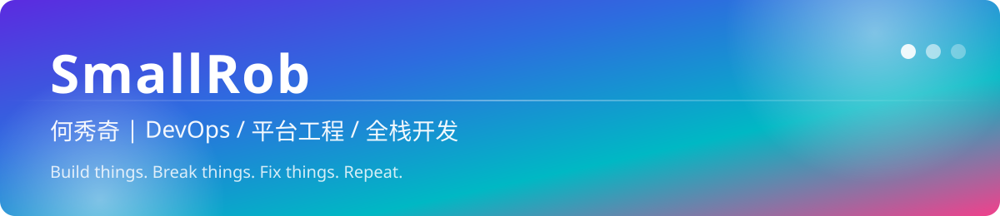
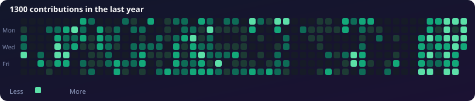

## About

全栈开发 / DevOps / 平台工程师。日常在三件事之间切换：

- **工业与桌面**：PLC 通讯工具集、.NET/C# WinForm 皮肤控件
- **平台与运维**：DBX 插件生态、SQL 评审、任务编排、ADS 制品交付
- **Steam 生态**：用户脚本、辅助插件、SteamKit / 数据分析工具链

技术栈以 TypeScript / JavaScript / Python / Go / C# 为主，偏好把重复劳动做成工具，把工具做成可复用的平台能力。

## Tech Stack

## Stats

## Selected Projects

展开 / 收起

| Project | Description | Stars | Forks | Updated |
| :--- | :--- | :---: | :---: | :---: |
| [PLC-CommunTools](https://github.com/SmallRob/PLC-CommunTools) | 针对工业上位机的通讯测试工具类及实例。包含各类厂商的PLC协议及基础的TCP、串口通讯、IO口通讯等协议通讯功能的实现整合，努力完善中。 | 788 | 221 | 2026-11-17 |
| [Taurus-CSSkinUI](https://github.com/SmallRob/Taurus-CSSkinUI) | CS架构的UI皮肤控件包，美观大方，针对WinForm、WPF（后续提供）等框架开发了不同版本 | 14 | 8 | 2026-11-02 |
| [nicekit-projects](https://github.com/SmallRob/nicekit-projects) | 由多个独立npm包组件集合而成的AI工具生态系统，专注于AI应用开发、CLI工具、MCP协议服务、Agent管理和Steam数据分析。 | 0 | 0 | 2026-08-21 |
| [task-orchestrator](https://github.com/SmallRob/task-orchestrator) | Task orchestrator service | 0 | 0 | 2026-11-16 |
| [dbx-ads-arm](https://github.com/SmallRob/dbx-ads-arm) | DBX plugin: ADS ARM/Kylin artifact agent | 0 | 0 | 2026-11-16 |
| [dbx-asdm-sqlreview](https://github.com/SmallRob/dbx-asdm-sqlreview) | DBX plugin: ASDM SQL review | 0 | 0 | 2026-11-16 |
| [dbx-sonar-quality](https://github.com/SmallRob/dbx-sonar-quality) | Read-only SonarQube quality workspace for DBX: projects, scans, issues and quality insights from PostgreSQL. | 0 | 0 | 2026-11-16 |
| [steam-tools](https://github.com/SmallRob/steam-tools) | Steam 相关独立工具集（从 steam-userscripts 剥离的独立工具项目） | 0 | 0 | 2026-11-17 |
| [steam-userscripts](https://github.com/SmallRob/steam-userscripts) | — | 0 | 0 | 2026-11-12 |
| [nice-today-2.0](https://github.com/SmallRob/nice-today-2.0) | — | 0 | 0 | 2026-05-03 |
| [itops-agent-platform](https://github.com/SmallRob/itops-agent-platform) | — | 0 | 0 | 2026-10-28 |
| [eagle-plugins](https://github.com/SmallRob/eagle-plugins) | Eagle 插件专用开发库：媒体收纳馆（影视/图书/游戏收纳）+ 百度街景收藏 | 0 | 0 | 2026-11-16 |

## Forked & Curated

展开 / 收起

| Project | Upstream | Description | Upstream Stars |
| :--- | :--- | :--- | :---: |
| [chinese-poetry](https://github.com/SmallRob/chinese-poetry) | [chinese-poetry/chinese-poetry](https://github.com/chinese-poetry/chinese-poetry) | The most comprehensive database of Chinese poetry 🧶最全中华古诗词数据库,  唐宋两朝近一万四千古诗人,  接近5.5万首唐诗加26万宋诗.  两宋时期1564位词人，21050首词。 | 54,452 |
| [danswer](https://github.com/SmallRob/danswer) | [onyx-dot-app/onyx](https://github.com/onyx-dot-app/onyx) | Gen-AI Chat for Teams - Think ChatGPT if it had access to your team's unique knowledge. | 33,447 |
| [romm](https://github.com/SmallRob/romm) | [rommapp/romm](https://github.com/rommapp/romm) | A beautiful, powerful, self-hosted rom manager and player. | 14,411 |
| [JKVideo](https://github.com/SmallRob/JKVideo) | [tiajinsha/JKVideo](https://github.com/tiajinsha/JKVideo) | 高颜值的第三方 B 站 React Native 客户端，支持安卓、H5、iOS | Bilibili-like app with DASH playback, danmaku, WBI sign & live streaming | 4,997 |
| [Musify](https://github.com/SmallRob/Musify) | [gokadzev/Musify](https://github.com/gokadzev/Musify) | Unlock the full potential of music: Stream effortlessly with one app! | 4,463 |
| [NOIR](https://github.com/SmallRob/NOIR) | [Verlintas/NOIR](https://github.com/Verlintas/NOIR) | 手机隐私审计：用 adb 扫出 Android 应用的权限、上报端点与数据流向，并给出可回滚的处置。Desktop Android leak audit: permissions, endpoints, data flows, reversible fixes. | 3,624 |
| [AugmentedSteam](https://github.com/SmallRob/AugmentedSteam) | [IsThereAnyDeal/AugmentedSteam](https://github.com/IsThereAnyDeal/AugmentedSteam) | Augments your Steam Experience | 1,793 |
| [Snowy](https://github.com/SmallRob/Snowy) | [xiaonuobase/Snowy](https://github.com/xiaonuobase/Snowy) | 💖Snowy是一款国内首个国密前后分离快速开发平台，采用Vue3+AntDesignVue3 + Vite+SpringBoot+Mp+HuTool+SaToken。集成国密加解密插件，在前后分离框架中，真正做到：前后分离“密”不可分；同时实现国产化机型、中间件、数据库适配，是您的不二之选；最后官网提供工作流、多租户、多数据源、Vue3表单设计器等丰富插件灵活使用。 | 825 |

## Activity

---

